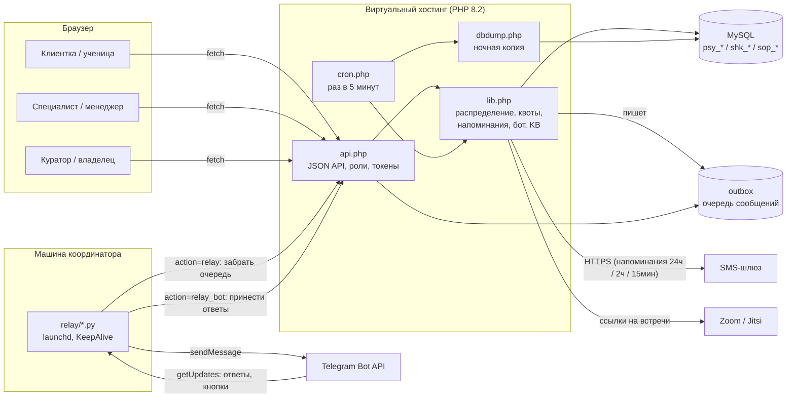

# Платформа записи к психологам

Платформа записи к психологам: агрегатор, внутренняя запись школы, кабинет сопровождения.
Три независимые системы на PHP 8.2 + MySQL + vanilla JS, которые за месяц выросли из одного
пилота записи: клиентки сами выбирают время, система распределяет их между специалистами
по квотам и приоритетам, напоминает по SMS и в Telegram и собирает отзывы и отчёты.

> Код опубликован с разрешения в обезличенном виде: удалены данные клиентов, ключи
> и адреса серверов. Имена людей в коде и комментариях заменены вымышленными, домены —
> на `example.com`.

## Контекст и задача

Заказчик — сеть образовательных и психологических сервисов («Академия психологии»):
школа, которая учит психологов и коучей, и поток клиентских консультаций со специалистами.
До проекта запись велась вручную в таблицах и переписках кураторов.

Нужно было быстро, на дешёвом виртуальном хостинге и без DevOps-команды:

- дать клиенткам самостоятельную запись без согласований в мессенджерах;
- равномерно и управляемо распределять клиенток между специалистами;
- снять с кураторов рутину напоминаний, переносов и сбора отчётов;
- позже — отдельно поддержать внутренних психологов школы и менеджеров онбординга,
  не смешивая данные и процессы.

## Приложения

### `apps/booking-aggregator` — агрегатор записи к специалистам (`/zapis`, таблицы `psy_*`)

Основная система: клиентка → специалист → куратор → владелец.

- **Запись «по времени, а не по человеку».** Клиентка выбирает тему (29 запросов в 6 разделах)
  и время; система в одной транзакции (`SELECT … FOR UPDATE`) назначает специалиста.
- **«Светофор» и квоты.** Приоритет специалиста (зелёный / жёлтый / красный) и квота
  клиентов: сначала приоритет, затем наименьшая загрузка. Кураторы управляют этим сами.
- **Единая база клиентов** со склейкой по телефону, Telegram и почте; история изменений
  записи с автором и каналом.
- **Отчёты и оценки** после встреч: специалист может поправить отчёт, прежний текст
  остаётся в истории; дашборд и статистика по периодам у координатора.
- **Уведомления:** SMS за сутки / 2 часа / 15 минут, Telegram-бот, тревога куратору,
  если за сутки до встречи специалист не назначен.
- **Бот с базой знаний** (`faq.php`): отвечает специалистам и кураторам по ключевым словам,
  незнакомое передаёт координатору.
- **Границы видимости:** специалист не видит квоты, оценки и чужую «кухню».

### `apps/school-booking` — внутренняя запись школы (`/shkola`, таблицы `shk_*`)

Отделённая от агрегатора система для штатных психологов школы.

- Конечный запас консультаций у ученицы по её курсу, месячная норма психолога.
- Заявка вместо прямой записи (модерация), лист ожидания, журнал отказов.
- Единый вход по почте и паролю (`password_hash`, сброс по одноразовой ссылке,
  блокировка подбора по IP) вместо трёх разных «дверей».
- Карточка ученицы: история встреч, в том числе у коллег; пауза и блокировка.
- Ссылки на встречи: своя комната специалиста, автосоздание Jitsi или Zoom (Server-to-Server OAuth).
- Личный кабинет ученицы, загрузка фото с проверкой типа файла.

### `apps/onboarding-cabinet` — кабинет менеджеров сопровождения (`/soprovod`, таблицы `sop_*`)

Онбординг новых учениц: 5 созвонов за 10 дней (дни 0/3/5/7/10), в финале — сертификат.

- Роли: ученица, менеджер (после подтверждения), куратор, владелец.
- График касаний «пройдено X из 5», итоги звонка для ученицы отдельно от внутренних заметок.
- Пары менеджеров (график 2/2), персональные ссылки менеджеров `?rec=…`,
  перестановка ученицы к другому менеджеру в один клик.
- Статистика «было / стало» за равные периоды, дайджест куратору в Telegram.
- Импорт учениц из школьного контура — **только чтение** `shk_clients`, с датой отсечки,
  чтобы старый список не подтягивался повторно.

### `relay/` — Telegram-реле, `deploy/` — выкладка и резервные копии

## Архитектура



Каждое приложение — самостоятельный SPA (`index.html` + `app.js` + `app.css`) с тремя входами
(`/`, `/spec/`, `/koordinator/`), JSON-API с диспетчером по `?action=` и ядром `lib.php`.
Схема БД создаётся и мигрируется кодом при старте (`initTables()` / `migrate()`),
поэтому выкладка — это просто копирование файлов.

## Стек

- **Backend:** PHP 8.2 без фреймворков, PDO + MySQL, cURL
- **Frontend:** vanilla JS (SPA без сборки), CSS
- **Интеграции:** Telegram Bot API (через реле), SMS-шлюз, Zoom Server-to-Server OAuth, Jitsi, вебхуки, импорт CSV из Google Sheets
- **Инфраструктура:** виртуальный хостинг, cron, git push-to-deploy, Python 3 (stdlib) для реле, launchd

## Инженерные решения

**Outbox + реле в обход блокировки хостинга.** Хостинг блокирует исходящие запросы к
`api.telegram.org`. Вместо смены хостинга PHP складывает сообщения в таблицу-очередь
(`*_outbox`), а реле на Python (только стандартная библиотека) на другой машине забирает её
по ключу (`hash_equals`), доставляет в Telegram, а входящие ответы и нажатия кнопок
приносит обратно на сервер. Вся логика бота остаётся на сервере, реле — чистый транспорт;
пока реле выключено, сообщения не теряются. Автозапуск — launchd с `KeepAlive`
(`relay/install-relay-launchd.sh`, ключ реле скрипт забирает с сервера сам).

**`git push` = деплой.** Хук `post-receive` (`deploy/post-receive`) делает бэкап текущей
версии, раскладывает `main` в папку сайта, проставляет `app.js?v=<время>` в три `index.html`
(cache-busting) и прогоняет `php -l` — результат приходит в ответ на push. Фронтенд
дополнительно сравнивает свою версию с `appVer()` сервера и предлагает обновиться.
Для контуров без git есть `deploy/deploy-rsync.sh` с теми же шагами, который трогает
только свою папку.

**Распределение без гонок.** Слот выбирается в транзакции с `FOR UPDATE`; ключ сортировки —
`приоритет × 10000 + загрузка`, с отсечкой по квоте. Ручное переназначение куратором идёт
по тому же механизму.

**Роли и границы видимости.** Клиентка, специалист, куратор, владелец; API отдаёт каждой роли
только её поля. Токены сессий в БД, ограничение попыток входа по IP. Настройки и ключи
интеграций хранятся в таблице настроек, а не в коде, и меняются владельцем в интерфейсе;
смена настроек пишется в журнал.

**Ночные копии базы с защитой от «тихих» сбоев.** `dbdump.php`: пароль — через временный
`--defaults-extra-file` (не светится в списке процессов), `mysqldump --result-file` вместо
конвейера `| gzip` (на хостинге конвейер обрывался с `errno 11` и давал битые копии),
`--no-tablespaces` (нет привилегии `PROCESS`), запасной дамп средствами PHP, проверка,
что дамп не обрезан, повтор после сбоя, тревога на почту, ротация две недели.

**Миграции в коде.** Схема досоздаётся при старте (`SHOW COLUMNS` → `ALTER TABLE`), включая
одноразовые миграции данных — например, полное удаление денежных полей из интерфейса и БД
по решению заказчика.

**Изоляция контуров.** Три системы с разными префиксами таблиц, ботами и ключами реле в одной
базе; единственная связь — read-only импорт из школы в сопровождение.

## Разобранные инциденты

- **Сайт сопровождения дважды исчезал.** Скрипт выкладки соседнего проекта делал
  `rsync --delete` в общий корень и исключал только известные ему папки. Исправлено
  исключением всех каталогов-соседей, включая будущие; БД не пострадала, восстановление —
  одной выкладкой.
- **Ученицы «не попадали» на созвон.** Менеджеры вводили ссылку на комнату без `https://` —
  браузер трактовал её как относительный путь. Добавлена нормализация схемы и валидация
  во всех трёх местах сохранения ссылки, битые записи вычищены.
- **Ночная копия неделю писалась в корень диска** — в планировщике хостинга пустой `HOME`.
  Путь теперь считается от файла скрипта.

Подробнее — в [`docs/case-study.md`](docs/case-study.md).

## Результаты

- **3 системы за ~3 недели** (18 августа — 8 сентября): агрегатор, внутренний контур школы
  (отделён в самостоятельный код и базу в первый день), кабинет сопровождения
  (построен и выложен за один день, затем доработан за две недели).
- **134 коммита** в агрегатор за первые две недели (18.08 — 02.09), 272 — к концу сентября.
- **~20 тыс. строк** кода (PHP, JS, CSS, Python, shell).
- Все три системы в проде: самостоятельная запись, распределение по приоритетам и квотам,
  SMS-напоминания и Telegram-бот заменили ручную координацию в таблицах и мессенджерах.
  по решению заказчика без потери самостоятельных регистраций.

## Структура репозитория

```
apps/
  booking-aggregator/   агрегатор записи (/zapis)
  school-booking/       внутренний контур школы (/shkola)
  onboarding-cabinet/   кабинет сопровождения (/soprovod)
  config.example.php    пример конфигурации БД и адреса сайта
relay/                  Telegram-реле (Python 3, stdlib) и установщик в launchd
deploy/                 post-receive хук, rsync-выкладка, резервная копия, пример deploy.env
docs/                   кейс
```

## Как запустить локально

Нужны PHP 8.2 (`pdo_mysql`, `curl`, `mbstring`) и MySQL 8 / MariaDB.

```bash
mysql -u root -e "CREATE DATABASE booking CHARACTER SET utf8mb4; \
  CREATE USER 'booking'@'localhost' IDENTIFIED BY 'change-me'; \
  GRANT ALL ON booking.* TO 'booking'@'localhost';"

cp apps/config.example.php apps/config.php      # и поправить доступы

# приложения ожидают адреса /zapis/, /shkola/, /soprovod/
mkdir -p .local
ln -s ../apps/booking-aggregator .local/zapis
ln -s ../apps/school-booking     .local/shkola
ln -s ../apps/onboarding-cabinet .local/soprovod
php -S localhost:8080 -t .local
```

Таблицы создаются при первом запросе. Дальше: `http://localhost:8080/zapis/`,
`/zapis/koordinator/` (код по умолчанию `0000`, сменить в «Настройках»), `/shkola/`, `/soprovod/`
(первый зарегистрированный аккаунт становится владельцем).
Telegram, SMS и Zoom без своих ключей не работают — интерфейс при этом доступен полностью.
Реле: `python3 relay/psy_relay.py --url http://localhost:8080/zapis/api.php --key <ключ из вкладки Telegram>`.

Честно: это прод-код небольшого проекта, а не шаблон — автотестов и Docker-окружения нет,
проверка шла на синтетических данных и через `php -l` при каждой выкладке.
